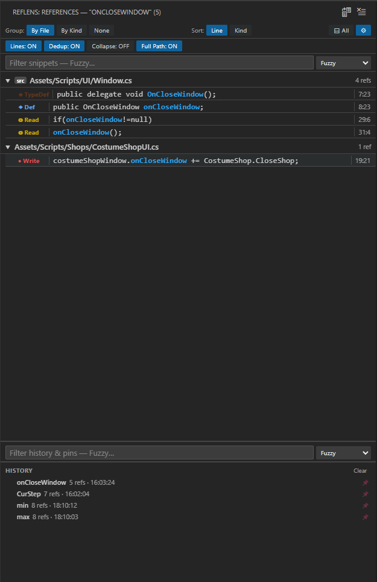

# RefLens

**RefLens** adds a dedicated sidebar panel that shows **Find All References** results grouped, sorted, and color-coded by reference kind — so you can navigate your codebase without losing context.



---

## Features

### Grouped results

References are organized so you can find what you need at a glance:

| Group mode | Description |
| --- | --- |
| **By File** | One collapsible section per file, sorted by reference count |
| **By Kind** | One section per kind (Definition, Read, Write…), each colored |
| **None** | Flat list across all files |

The **View** toggle is independent of the group mode: **Flat** lists groups as before, **Tree** nests files under a collapsible folder tree (inside each kind for By Kind). **Alt+click** a group header to expand/collapse all nested groups. View has no effect with None.

### Reference kinds with color and icon

Every reference is tagged with its semantic role:

| Icon | Kind | Color |
| --- | --- | --- |
| ◆ | Definition | Blue |
| ▶ | Implementation | Green |
| ◇ | Declaration | Purple |
| ◈ | TypeDefinition | Orange |
| ◎ | Read | Yellow |
| ● | Write | Red |
| ○ | Reference | Default |

### Sort order

Within any group mode, toggle between:

- **Line** — ascending line number (default)
- **Kind** — by semantic role, then by line

### Symbol highlighting

The searched symbol is highlighted inside every snippet so it's always easy to spot.

### Auto-update on cursor move

Enable **Auto-Update** to have RefLens automatically refresh results as you move the cursor. A configurable debounce delay (default 500 ms) prevents unnecessary work while you navigate.

### Grid lines

Toggle the **Lines** button to draw borders between columns (Kind, Snippet, Location) for easier scanning.

---

## Usage

1. Click the **RefLens** icon in the Activity Bar to open the panel.
2. Place the cursor on any symbol in the editor.
3. Click **Find References** ($(references) icon in the panel toolbar) — or right-click the editor and choose **RefLens: Find References at Cursor**.
4. Results appear instantly, grouped and sorted. Click any row to jump to that location.

---

## Commands

| Command | Description |
| --- | --- |
| `RefLens: Find References at Cursor` | Run search from the current cursor position |
| `RefLens: Clear Results` | Clear the panel |
| `RefLens: Toggle Auto-Update on Cursor Move` | Enable / disable live refresh |

---

## Settings

| Setting | Default | Description |
| --- | --- | --- |
| `reflens.autoUpdate` | `false` | Refresh automatically when the cursor moves |
| `reflens.debounceMs` | `500` | Delay in ms before auto-refresh fires |
| `reflens.maxSnippetLength` | `120` | Maximum characters shown per snippet |
| `reflens.deduplicateLines` | `false` | Hide duplicate references on the same line (keeps the highest-priority kind) |
| `reflens.collapseAll` | `false` | Start with all groups collapsed when results are shown |
| `reflens.showFullPath` | `false` | Show full relative path instead of just the filename in results |

---

## Requirements

Any language with a reference provider (TypeScript, JavaScript, C#, Go, Python, Rust, etc.). RefLens delegates all symbol resolution to the active language server — no additional setup needed.

---

## Install from source (local)

Build a `.vsix` and install it into your local VS Code. Requires Node.js.

```bash
npm install
npx @vscode/vsce package --allow-missing-repository
"/Applications/Visual Studio Code.app/Contents/Resources/app/bin/code" --install-extension reflens-1.0.0.vsix --force
```

(On macOS the full path to the `code` binary is used because the `code` shell command may open a new window instead of running the CLI. If `code` is on your PATH, `code --install-extension ...` works too.)

Then run **Developer: Reload Window**. `--force` replaces any already-installed RefLens, including the marketplace version.

To iterate without installing, open the folder in VS Code and press **F5** to launch an Extension Development Host.
